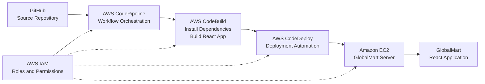

# AWS CI/CD Architecture

## GlobalMart Deployment Architecture

The following diagram illustrates the intended CI/CD workflow for deploying the GlobalMart React application to Amazon EC2.

## Deployment Workflow

1. Developers push application changes to GitHub.
2. GitHub triggers the CodePipeline source stage.
3. CodePipeline initiates the CodeBuild stage.
4. CodeBuild installs dependencies and generates the production build.
5. CodeDeploy manages the deployment to the EC2 instance.
6. The EC2 instance hosts the GlobalMart application.

## Deployment Target

- EC2 Instance: `GlobalMart-Server`
- CodePipeline: `GlobalMart-Pipeline`
- CodeDeploy Application: `GlobalMart-Catalog`
- Deployment Group: `GlobalMart-Production`

**Note:** The deployment workflow is still undergoing troubleshooting. The diagram represents the intended architecture, not a verified successful deployment.
